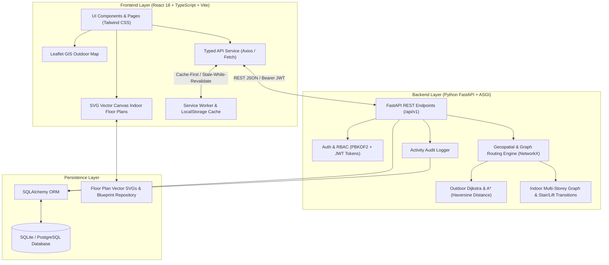
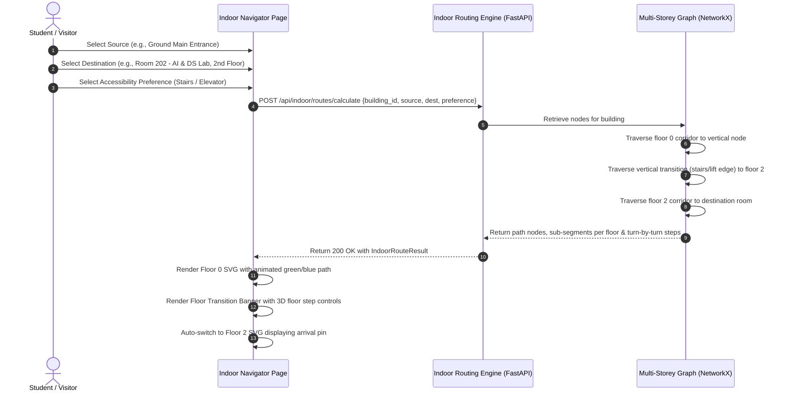
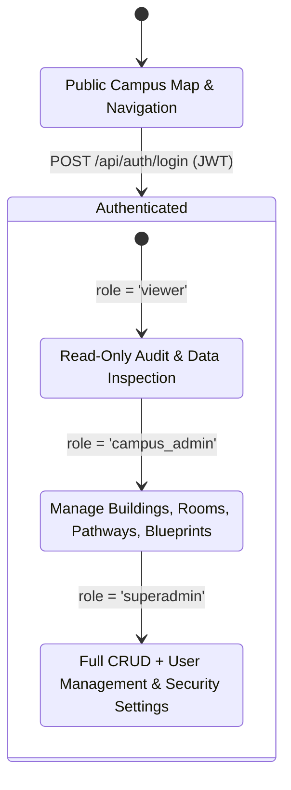

# YTC Campus Navigator - Architectural Specification
**Institution:** Yashoda Technical Campus (YTC), Satara, Maharashtra, India  
**Project Category:** Smart Campus Geospatial Discovery & Navigation System  
**Academic Year:** Third-Year AI & Data Science Engineering  

---

## 1. Executive Architecture Summary

YTC Campus Navigator is built on a clean, decoupled, layered micro-architecture designed to deliver high performance, offline resilience, and precise outdoor and multi-storey indoor navigation.



---

## 2. Key Architectural Tenets

1. **Decoupled Architecture:** Frontend and backend communicate purely via structured JSON REST APIs over HTTP/HTTPS, enabling independent scalability, containerization, and cross-platform clients (e.g. mobile apps).
2. **Normalized Relative Spatial Coordinates:** All indoor room markers and navigation nodes use relative normalized coordinates $(x, y) \in [0.0, 1.0]$. This guarantees that regardless of screen resolution, viewport resizing, device pixel ratio, or blueprint image replacement, coordinates remain pixel-perfect.
3. **Dual-Tier Graph Routing Engine:**
   - Outdoor: Geospatial graph using WGS84 GPS latitude/longitude coordinates and Haversine metric distances.
   - Indoor: Directed multi-storey graph utilizing Euclidean distance on floor planes connected by vertical edges (stairs/elevators).
4. **Offline-First Resilience:** The application is architected to operate even when campus WiFi or cellular connectivity is intermittent. Core assets, blueprints, and fallbacks are cached by the browser Service Worker and LocalStorage.
5. **Role-Based Access Control (RBAC):** Three distinct privilege tiers (`superadmin`, `campus_admin`, `viewer`) secure sensitive configuration routes while keeping navigation endpoints public.

---

## 3. Outdoor Navigation Engine

### 3.1 Geospatial Graph Construction
The campus grounds are represented as a weighted undirected graph $G_{outdoor} = (V, E)$:
- **Vertices ($V$):** Campus entrance gates, pathway intersections, building entry porticos, parking lots, canteen plazas, sports complexes.
- **Edges ($E$):** Paved pedestrian walkways, roads, and ramps.

### 3.2 Distance & Heuristic Computation
The edge weights represent real-world physical walking distances calculated using the Haversine formula:

$$\Delta\sigma = 2 \arcsin \sqrt{\sin^2\left(\frac{\Delta\phi}{2}\right) + \cos\phi_1 \cos\phi_2 \sin^2\left(\frac{\Delta\lambda}{2}\right)}$$

$$d = R \cdot \Delta\sigma$$

Where $R = 6,371,000\text{ meters}$, $\phi$ is latitude in radians, and $\lambda$ is longitude in radians.

### 3.3 Pathfinding Algorithms
- **Dijkstra's Algorithm:** Guarantees optimal shortest path by exploring lowest cumulative cost:
  $$d(u) = \min_{v \in adj(u)} (d(v) + w(v, u))$$
  Time Complexity: $\mathcal{O}((V + E) \log V)$ using a binary min-heap priority queue.
- **A\* Algorithm:** Incorporates a Euclidean or Haversine distance heuristic $h(n)$ to direct path search towards destination:
  $$f(n) = g(n) + h(n)$$
  Significantly reduces the search space for large campus networks.
- **Wheelchair Accessibility Mode:** Graph edge filters dynamically prune pathways with `wheelchair_accessible == False` (e.g., stairs, steep steps, gravel paths).

---

## 4. Indoor Multi-Storey Navigation Engine



### 4.1 Normalized Spatial Coordinate Mapping
Indoor rooms and waypoints are stored as:
$$\text{Relative } x = \frac{\text{Pixel } X}{\text{Image Width}} \in [0.0, 1.0]$$
$$\text{Relative } y = \frac{\text{Pixel } Y}{\text{Image Height}} \in [0.0, 1.0]$$

During frontend rendering:
$$\text{Screen } X = \text{Container Width} \times \text{Relative } x$$
$$\text{Screen } Y = \text{Container Height} \times \text{Relative } y$$

This mathematical abstraction ensures:
- Visual stability across smartphones, tablets, and high-DPI desktop screens.
- Zero coordinate drift when architectural blueprints or SVG artwork are updated.

### 4.2 Multi-Floor Transitions
Floors are connected via vertical transition edges:
- `staircase`: Accessible for able-bodied users, zero energy latency.
- `lift`: Filtered as preferred/required for wheelchair or accessibility mode.

---

## 5. Unified Outdoor-to-Indoor Seamless Transition

When navigating from an outdoor location (e.g., Main Entrance Gate) to an indoor classroom (e.g., Pharmacy Seminar Hall, 1st Floor):
1. **Leg 1 (Outdoor):** Outdoor routing engine guides user from Main Gate $\to$ Pharmacy Building Entrance Portico.
2. **Automatic Context Handover:** When the destination building entrance is reached, the UI presents an interactive prompt: *"You have arrived at Pharmacy Block. Switch to Indoor Floor Plan?"*
3. **Leg 2 (Indoor):** Indoor routing engine automatically sets the building entrance as the starting node and guides the user to the destination classroom.

---

## 6. Offline-First Architecture & Caching Strategy

```mermaid
flowchart LR
    Request["User Request (Page / API / SVG)"] --> SW{"Service Worker Active?"}
    SW -->|Yes| SWCheck{"Resource Type?"}
    SW -->|No / Unsupported| Network["Network Fetch"]

    SWCheck -->|Static Asset / SVG / JS / CSS| CacheFirst["Cache-First Strategy"]
    CacheFirst --> CacheHit{"In Cache?"}
    CacheHit -->|Yes| ReturnCache["Return Cached Asset"]
    CacheHit -->|No| FetchAndCache["Network Fetch & Save to Cache"]

    SWCheck -->|API Data (/api/*)| NetworkFirst["Network-First Strategy"]
    NetworkFirst --> NetSuccess{"Network Available?"}
    NetSuccess -->|Yes| UpdateCache["Return Live Data & Cache"]
    NetSuccess -->|No| FallbackCache["Return LocalStorage Fallback"]
```

1. **Service Worker (`sw.js`):**
   - Precaches app shell (`index.html`, logo SVGs, floor plan blueprints).
   - Stale-While-Revalidate pattern for CSS/JS bundles.
2. **Client-Side LocalStorage Fallbacks:**
   - Pre-seeded campus buildings, rooms, POIs, and walkway nodes are hardcoded as resilient client-side fallbacks.
   - If the backend is offline or unresponsive, all queries, search operations, and route calculations gracefully execute client-side.
3. **Network Status Indicator:**
   - Listens to `window.addEventListener('online')` and `'offline'`.
   - Displays gentle notification pill informing the user that offline cached data is being served.

---

## 7. Security & Role-Based Access Control (RBAC)



- **Password Storage:** Salted PBKDF2 with SHA-256 (600,000 iterations).
- **Session Tokens:** Stateless JSON Web Tokens (JWT) signed with HMAC-SHA256 containing expiration, subject email, and user role.
- **Enforcement:** FastAPI dependency injection (`get_current_user`, `get_admin_user`, `get_superadmin_user`) guarantees zero unauthorized access to administrative endpoints.

