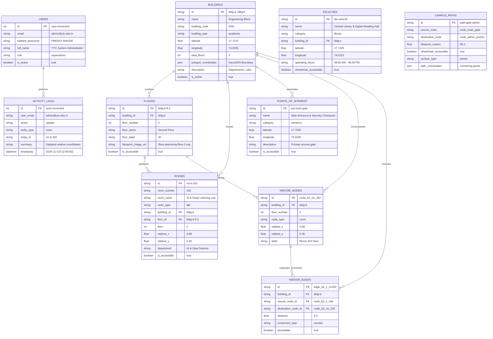

# YTC Campus Navigator - Database Schema & Data Dictionary
**Institution:** Yashoda Technical Campus (YTC), Satara, Maharashtra, India  
**Project Category:** Smart Campus Geospatial Discovery & Navigation System  
**Academic Year:** Third-Year AI & Data Science Engineering  

---

## 1. Entity-Relationship Overview

The database uses a relational model implemented via SQLAlchemy ORM with SQLite (development/offline) and full compatibility with PostgreSQL (production).

---

## 2. Table Specifications & Data Dictionary

### 2.1 `buildings` Table
Stores structural information for Yashoda Technical Campus campus edifices.

| Column Name | Data Type | Nullable | Primary / Foreign | Description |
|---|---|---|---|---|
| `id` | VARCHAR(64) | No | Primary Key | Unique slug identifier (e.g. `bldg-a`, `bldg-b`) |
| `name` | VARCHAR(255) | No | - | Official building name |
| `building_code` | VARCHAR(32) | No | Index | Short abbreviation (e.g. `ENG`, `PHARM`, `ADMIN`) |
| `building_type` | VARCHAR(64) | No | Index | Type (`academic`, `administrative`, `hostel`, `amenity`) |
| `latitude` | FLOAT | No | Index | WGS84 GPS latitude |
| `longitude` | FLOAT | No | Index | WGS84 GPS longitude |
| `total_floors` | INTEGER | No | - | Total above-ground storeys |
| `polygon_coordinates` | JSON | Yes | - | Array of `[lat, lng]` forming outer building perimeter |
| `description` | TEXT | Yes | - | Department listings, facilities, notes |
| `is_active` | BOOLEAN | No | - | Active visibility toggle |

### 2.2 `floors` Table
Represents individual architectural storeys within buildings.

| Column Name | Data Type | Nullable | Primary / Foreign | Description |
|---|---|---|---|---|
| `id` | VARCHAR(64) | No | Primary Key | Unique composite slug (e.g. `bldg-b-fl-2`) |
| `building_id` | VARCHAR(64) | No | Foreign Key (`buildings.id`) | Parent building reference |
| `floor_number` | INTEGER | No | Index | Zero-indexed level (0 = Ground, 1 = 1st, 2 = 2nd) |
| `floor_name` | VARCHAR(128) | No | - | Descriptive name (e.g. `Second Floor - AI & DS`) |
| `floor_label` | VARCHAR(32) | No | - | Badge label (e.g. `2F`, `GF`) |
| `blueprint_image_url`| VARCHAR(512)| Yes| - | Relative/CDN URL to floor plan vector SVG/PNG |
| `is_accessible` | BOOLEAN | No | - | Elevator/ramp access status |

### 2.3 `rooms` Table
Classrooms, research laboratories, faculty cubicles, and student halls.

| Column Name | Data Type | Nullable | Primary / Foreign | Description |
|---|---|---|---|---|
| `id` | VARCHAR(64) | No | Primary Key | Unique room slug (e.g. `rm-b-202`) |
| `room_number` | VARCHAR(64) | No | Index | Door number (e.g. `202`, `LH-01`) |
| `room_name` | VARCHAR(255) | No | Index | Human-readable title (e.g. `AI & Deep Learning Lab`) |
| `room_type` | VARCHAR(64) | No | Index | `lab`, `classroom`, `seminar_hall`, `faculty_room`, `office` |
| `building_id` | VARCHAR(64) | No | Foreign Key (`buildings.id`) | Building location |
| `floor_id` | VARCHAR(64) | No | Foreign Key (`floors.id`) | Floor level reference |
| `floor` | INTEGER | No | - | Floor number redundancy for quick indexing |
| `relative_x` | FLOAT | No | - | Normalized coordinate $X \in [0.0, 1.0]$ |
| `relative_y` | FLOAT | No | - | Normalized coordinate $Y \in [0.0, 1.0]$ |
| `department` | VARCHAR(128) | Yes | - | Associated academic branch |
| `is_accessible` | BOOLEAN | No | - | Accessible entry door |

### 2.4 `indoor_nodes` & `indoor_edges` Tables
Directed multi-storey graph representing indoor hallway networks.

- `indoor_nodes`:
  - `node_type`: `room`, `corridor`, `intersection`, `staircase`, `lift`, `entrance`, `washroom`.
  - `relative_x`, `relative_y`: Position on active floor plan canvas.
- `indoor_edges`:
  - `source_node_id`, `destination_node_id`: Connected vertices.
  - `movement_type`: `corridor`, `staircase`, `lift`, `door`.
  - `distance`: Metric walking distance in meters.
  - `accessible`: True if accessible without stair climbing.

### 2.5 `users` & `activity_logs` Tables
Secures administrative access and records non-repudiable audit logs.

- `users`:
  - `role`: `superadmin` (full permissions), `campus_admin` (campus data management), `viewer` (read-only audit access).
  - `hashed_password`: Salted PBKDF2 with SHA-256 string.
- `activity_logs`:
  - `action`: `create`, `update`, `delete`, `upload`, `login`.
  - `entity_type`: `building`, `floor`, `room`, `facility`, `path`, `floor_plan`, `user`.
  - `summary`: Human-readable description of change.
  - `timestamp`: ISO-8601 UTC timestamp.

---

## 3. Database Indexes & Query Optimization

1. **Composite Geographic Index:** `buildings(latitude, longitude)` for spatial bounding box lookups.
2. **Floor & Building Foreign Key Indexes:** `rooms(building_id, floor_id)` to ensure sub-millisecond retrieval of floor directories.
3. **Audit Trail Sorting Index:** `activity_logs(timestamp DESC)` for paginated audit log feeds.
4. **Full-Text Tokenization:** In-memory or indexed search on `room_name`, `room_number`, and `building_name` for instant student queries.
