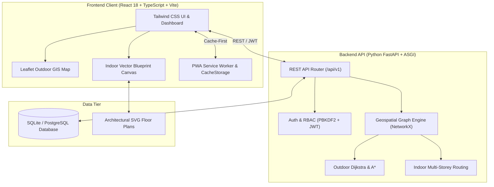

# YTC Campus Navigator

<div align="center">


### Yashoda Technical Campus, Satara
**॥ ज्ञानम् जीवनस्य भूषणम् ॥**

# YTC Campus Navigator
### Smart Outdoor & Indoor Campus Navigation System
**Yashoda Technical Campus, Satara, Maharashtra, India**  
*Faculty of Engineering • Department of Artificial Intelligence & Data Science*

[](https://github.com/AlokXCreate/ytc-campus-navigator/actions)
[](https://fastapi.tiangolo.com)
[](https://react.dev)
[](https://www.typescriptlang.org)
[](https://python.org)
[](https://tailwindcss.com)
[](https://leafletjs.com)
[](https://pytest.org)
[](https://web.dev/progressive-web-apps/)
[](https://alokxcreate.github.io/ytc-campus-navigator/downloads/ytc-campus-navigator.apk)

[🌐 Live Web Application](https://alokxcreate.github.io/ytc-campus-navigator/) • [📱 Download Android APK](https://alokxcreate.github.io/ytc-campus-navigator/downloads/ytc-campus-navigator.apk) • [Project Overview](docs/project-demo/PROJECT_OVERVIEW.md) • [Architecture](ARCHITECTURE.md) • [Database Schema](DATABASE_SCHEMA.md) • [API Docs](API_DOCUMENTATION.md) • [Viva Questions](docs/project-demo/VIVA_QUESTIONS.md)

</div>

---

## 🌟 Executive Summary

**YTC Campus Navigator** is a production-ready, full-stack spatial discovery and navigation system designed specifically for **Yashoda Technical Campus (YTC), Satara**. 

Developed as a third-year Artificial Intelligence and Data Science engineering project, the application bridges the gap left by commercial mapping services like Google Maps, which terminate at external campus gates and cannot navigate internal walkways or multi-storey buildings. 

The application couples an interactive OpenStreetMap outdoor GIS canvas with vector architectural floor plans, calculating shortest pedestrian routes dynamically using **Dijkstra's** and **A\*** graph search algorithms. It introduces an innovative **normalized spatial coordinate system** $[0.0, 1.0]$ for multi-storey indoor guidance and features a no-code visual admin suite and offline-first Progressive Web App (PWA) resilience.

---

## 🚀 Key Feature Highlights

### 1. Interactive Outdoor Campus Map
- **Geospatial GIS Engine:** High-performance Leaflet.js rendering OpenStreetMap tiles with verified Yashoda Technical Campus campus polygons and boundary coordinates.
- **Shortest Walking Routes:** Python NetworkX graph engine computing shortest paths based on Haversine physical distance.
- **WGS84 GPS Tracking:** One-click *"My Location"* GPS positioning with blue pulse accuracy indicator and nearest-node snapping.
- **Wheelchair Accessibility Mode:** Dynamically prunes non-accessible terrain, steps, and staircases for step-free barrierless transit.
- **Turn-by-Turn Guidance:** Realistic cardinal compass instructions (e.g. *"Walk North-East towards Central Library"*).

### 2. Multi-Storey Indoor Navigation
- **Multi-Building Support:** Pre-configured for Engineering Block, Pharmacy Block, Administrative Complex, and Central Library.
- **Normalized Coordinate Canvas:** Classrooms and waypoints adhere to relative $(x, y) \in [0.0, 1.0]$, ensuring pixel-perfect scaling across phones, tablets, and 4K displays.
- **Multi-Floor Vertical Routing:** Seamless routing between floors via staircases or elevators with floor-transition instructions.
- **Classroom & Lab Finder:** Detailed directory cards for classrooms, AI labs, seminar halls, and faculty cabins.
- **Seamless Outdoor-to-Indoor Transition:** Auto-detects arrival at a building entrance and prompts the user to switch into indoor floor plans.

### 3. Visual Administration Portal (`/admin`)
- **Visual Room Pin Positioner:** Interactive blueprint canvas allowing administrators to click directly on classroom doors to record normalized coordinates.
- **Indoor Pathway Simulator:** Test and visualize Dijkstra indoor path computations before publishing.
- **GeoJSON Import & Validation:** Paste and validate spatial GeoJSON FeatureCollections with instant geometric checks.
- **One-Click Data Export:** Export campus records to JSON, CSV, or GeoJSON.
- **Role-Based Access Control (RBAC):** Tiered roles (`superadmin`, `campus_admin`, `viewer`) secured via salted PBKDF2 hashing and stateless JWT tokens.
- **Activity Audit Trail:** Immutable log of all administrative creations, updates, and deletions.

### 4. Offline-First Progressive Web App (PWA)
- **Service Worker (`sw.js`):** Cache-First caching strategy for application shell, static assets, and vector blueprint SVGs.
- **Resilient Fallback Cache:** Pre-seeded client data cache guarantees uninterrupted search and route calculation during campus cellular drops.
- **Network Status Banner:** Non-intrusive alert notifying users when running in cached offline mode.

### 5. Multi-Layer Google Maps GIS Engine & Clear Basemaps
- **Google Maps Satellite (Hybrid) View:** High-resolution aerial satellite imagery with roads and landmarks overlaid directly on Yashoda Technical Campus terrain.
- **Google Maps Streets & Terrain Layers:** Instant floating switcher between OpenStreetMap Classic, Google Satellite Hybrid, Google Streets, Google Terrain, and Carto Light.
- **Native Google Maps Directions Integration:** One-tap button to open any selected building or POI directly in Google Maps for external navigation to campus gates.

### 6. Institutional Intro, Multi-Role Auth & Profile Onboarding
- **Official Yashoda Technical Campus Emblem:** High-fidelity intro animation with radiant aura and the revered Sanskrit motto: *॥ ज्ञानम् जीवनस्य भूषणम् ॥* ("Knowledge is the ornament of life").
- **Firebase & Google Authentication:** Integrated Google Sign-In, Email/Password authentication, and 1-Click Guest Access with resilient offline demo fallback.
- **Multi-Role Support:** Distinct experiences for **Students**, **Faculty**, **Campus Visitors**, and **Administrators**.
- **Complete Profile Setup:** Comprehensive onboarding capturing Full Name, College, Department, Phone, Residential Address/City, Gender, Profile Avatar, and Roll/Staff ID.
- **User Profile Drawer:** Header-accessible slide-out drawer with quick profile inspection, edit options, and secure sign-out.

### 7. Google Maps-Style Turn-by-Turn Voice Navigation HUD
- **Real-Time Spoken Voice Navigation:** Native Web Speech API announces directional turn prompts (*"Starting route to Central Library"*, *"In 30 meters, turn right toward Engineering Block"*, *"You have arrived at your destination"*).
- **Maneuver HUD Overlay:** Prominent Google Maps navigation header with large dynamic maneuver arrows (Turn Left, Turn Right, Straight, Arrive), distance countdown, and next-maneuver preview.
- **Navigation Cockpit:** Floating dashboard displaying remaining distance, remaining walk minutes, live calculated ETA, step-by-step advance controls, and mute/unmute audio button.
- **Simulate GPS Walking Animation:** 1-Click demo simulator that walks the blue navigation avatar along the polyline, auto-panning the camera and announcing each turn aloud.

### 8. Native Android Mobile Application (.APK)
- **Universal Android APK:** Native Android package compiled via Capacitor Android and Gradle with target SDK 36.
- **Direct Download:** Download the standalone release APK directly from the live web application at `/downloads/ytc-campus-navigator.apk`.
- **Sensors & Permissions:** Full access to high-accuracy GPS hardware (`ACCESS_FINE_LOCATION`), cellular triangulation, and turn-warning vibration feedback (`VIBRATE`).

---

## 🏗️ System Architecture



---

## 💻 Tech Stack

| Layer | Technologies |
|---|---|
| **Frontend UI** | React 18, TypeScript, Tailwind CSS, Lucide React, Vite SPA |
| **Mapping & GIS** | Leaflet 1.9, React-Leaflet, OpenStreetMap, GeoJSON |
| **Backend API** | Python 3.11+, FastAPI (ASGI), Uvicorn, Pydantic V2 |
| **Graph Algorithms** | NetworkX, Dijkstra's Algorithm, A* Algorithm, Haversine Distance |
| **Database & ORM** | SQLAlchemy 2.0, SQLite (Dev), PostgreSQL (Production ready) |
| **Security & Auth** | Salted PBKDF2-SHA256, PyJWT (HMAC-SHA256), FastAPI Dependencies |
| **PWA & Offline** | Web App Manifest, Service Worker API, CacheStorage, LocalStorage |
| **Testing & CI/CD** | Pytest (28 automated tests), TypeScript strict compiler, GitHub Actions |
| **Deployment** | Docker, Nginx Reverse Proxy, Docker Compose |

---

## ⚡ Quick Start Guide

### Option 1: Docker Compose (Fastest & Production-Ready)
```bash
# 1. Clone repository
git clone https://github.com/AlokXCreate/ytc-campus-navigator.git
cd ytc-campus-navigator

# 2. Launch backend & frontend containers
docker compose up -d --build
```
- Web Application: `http://localhost:3000`
- Interactive Swagger API Docs: `http://localhost:8000/docs`

---

### Option 2: Local Development Setup

#### 1. Backend Setup
```bash
cd backend

# Create virtual environment
python -m venv .venv

# Activate virtual environment
# Windows (PowerShell):
.\.venv\Scripts\Activate.ps1
# Linux / macOS:
source .venv/bin/activate

# Install dependencies
pip install -r requirements.txt
pip install pytest httpx

# Seed database with Yashoda Technical Campus campus data
python -m app.database.seed_data

# Run automated tests
python -m pytest tests/ -v

# Start FastAPI server
uvicorn app.main:app --host 0.0.0.0 --port 8000 --reload
```

#### 2. Frontend Setup
```bash
cd frontend

# Install npm dependencies
npm install

# Run TypeScript compile & start Vite dev server
npm run dev
```
Frontend launches at: `http://localhost:5173`.

---

## 🔐 Administrative Access & Credentials

The database is pre-seeded with tiered administrative accounts:

| Role | Email Address | Password | Permissions |
|---|---|---|---|
| **Super Admin** | `admin@ytc.edu.in` | `ytcadmin2026` | Full access, user provisioning, system settings |
| **Campus Admin** | `manager@ytc.edu.in` | `manager123` | Buildings, rooms, pathways, blueprints |
| **Auditor / Viewer** | `viewer@ytc.edu.in` | `viewer123` | Read-only inspection & audit log review |

---

## 🧪 Automated Testing Suite

The backend test suite verifies graph routing optimality, multi-floor transitions, and security:
```bash
cd backend
python -m pytest tests/ -v
```
**Test Session Results:**
```
tests/test_admin.py .........                                  [ 32%]
tests/test_api.py ....                                         [ 46%]
tests/test_indoor_routing.py ......                            [ 67%]
tests/test_routing.py .........                                [100%]

======================= 28 passed in 2.02s =======================
```

Frontend compilation:
```bash
cd frontend
npm run build   # tsc && vite build -> 0 errors!
```

---

## 📚 Comprehensive Documentation Catalog

- **[System Architecture](ARCHITECTURE.md):** Deep-dive into geospatial graph design, normalized coordinates, and multi-storey topology.
- **[Database Schema](DATABASE_SCHEMA.md):** ER diagrams, table definitions, foreign keys, and indexes.
- **[REST API Specification](API_DOCUMENTATION.md):** Complete OpenAPI endpoint documentation with sample payloads.
- **[Testing Report](TESTING.md):** Test pyramid, automated test matrix, and manual QA scenarios.
- **[Student & Visitor Guide](USER_GUIDE.md):** User manual for outdoor navigation, indoor finding, and PWA installation.
- **[Administrator Handbook](ADMIN_GUIDE.md):** Guide to visual room pin placement, walkway editing, and GeoJSON import.
- **[Deployment Guide](DEPLOYMENT.md):** Cloud hosting on Render, Vercel, VPS Nginx, and Docker.
- **[Engineering Limitations](LIMITATIONS.md):** Technical trade-offs, GPS precision, and mitigations.
- **[Academic Demo Script](docs/project-demo/DEMO_SCRIPT.md):** 10-minute presentation guide for project evaluation.
- **[Viva Voce Q&A](docs/project-demo/VIVA_QUESTIONS.md):** 25+ academic viva questions with detailed answers.
- **[Future Roadmap](docs/project-demo/FUTURE_SCOPE.md):** Augmented reality, BLE beacons, and timetable integration.

---

## 🏛️ Institutional Attribution

- **Institution:** Yashoda Technical Campus, Satara (YTC)
- **Approved By:** AICTE, DTE Maharashtra; Affiliated to Shivaji University, Kolhapur / DBATU, Lonere
- **Campus Address:** S. No. 242/1, NH-4, Wadhe Phata, Satara – 415011, Maharashtra, India
- **Department:** Artificial Intelligence and Data Science Engineering
- **Project Lead / Author:** Alok (@AlokXCreate)

---

## 📄 License
This academic project is open-source and released under the MIT License.
