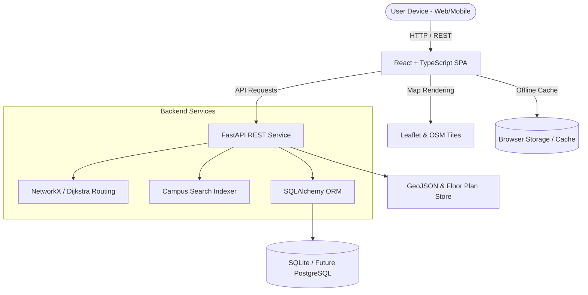

# YTC Campus Navigator - Architecture Design Document

## 1. System Overview

YTC Campus Navigator is designed as a client-server web application for Yashoda Technical Campus, Satara. The architecture decouples the responsive presentation layer from a high-performance Python FastAPI service, supported by local caching for offline accessibility.

## 2. Frontend Layer

- **Framework**: React 18 with TypeScript, bundled by Vite for ultra-fast HMR and building.
- **Styling**: Tailwind CSS with custom academic palette (Slate, Deep Navy `#0f172a`, Accent Blue `#2563eb`).
- **Icons**: Lucide React.
- **Mapping**: Leaflet with OpenStreetMap tiles and custom GeoJSON overlay layers.
- **Indoor View**: Interactive SVG & HTML5 Canvas floor-plan projection with normalized coordinates.
- **State & Service Layer**: React Context & Hooks with a decoupled API client (`src/services/api.ts`) that gracefully falls back to local JSON cache when offline or if the backend is unreachable.

## 3. Backend Layer

- **Framework**: FastAPI (Python 3.10+).
- **ORM**: SQLAlchemy with declarative models and session lifecycle.
- **Validation**: Pydantic v2 schemas for all request/response models.
- **Pathfinding Engine**: Dijkstra and A* pathfinding using graph representation of campus walkways, building connections, and entrances.
- **Database**: SQLite for lightweight zero-config local development, easily migratable to PostgreSQL/PostGIS.

## 4. Campus Coordinate System

- **Outdoor Datum**: WGS84 (Standard GPS Latitude/Longitude).
- **Campus Center (Demonstration point)**: Satara Wadhe Phata region (`17.7215° N, 74.0205° E`). All coordinates are explicitly marked as editable demonstration data until ground-truth survey measurements are conducted.
- **Indoor Coordinate Space**: Relative coordinate system (`relative_x`: 0.0 to 1.0, `relative_y`: 0.0 to 1.0) normalized across all floor plan images and SVGs.
